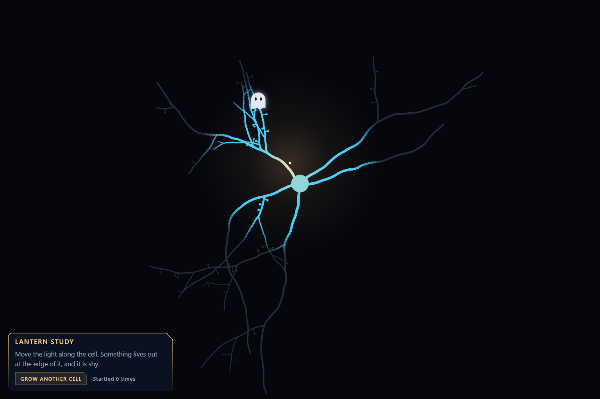

# Lantern Study

*One cell in the dark, a light, and something shy.*

The work is a web page that a visitor moves a light across. This text is the same work for a reader who cannot run a page. Every number below is taken from the page's source.

## The cell

When the page opens, a cell is grown. A round cell body sits a little above the middle. Five, six or seven thick branches leave it in different directions. Each one wanders, thins as it goes, and may fork, and the forks may fork, five deep at most. The finer branches carry spines, short stubs with a small round head.

The whole cell is drawn once in a grey barely lighter than the dark behind it. It is different every time. A button grows another.

## The light

The visitor's pointer is the light. Its reach is about a fifth of the shorter side of the window.

Within four fifths of that reach the cell is fully lit, and it is blue. Over the next two fifths the blue fades back to grey. Close to the flame, inside the nearest 45 percent, the blue warms toward the colour of the flame itself.

The flame flickers by about two percent. If the visitor leaves it alone for three and a half seconds, the light begins to stroll round the cell by itself.

Nothing on the page has any colour until the light reaches it.

## The ghost

There is one.

It settles on a branch somewhere between 0.85 and 1.5 reaches from the light, so it begins either just inside the edge or just outside it. It is seen only as far as the light finds it: whole inside one reach, fainter beyond, gone at one and a half.

If the flame comes within 0.42 of a reach, the ghost rises and fades. That takes three tenths of a second. A count on the page goes up by one.

Two seconds later it settles on another branch, never near the one it left.

It cannot be caught. Nothing happens at any count.

## Three stills

These are one cell, grown once, on the day the page was made.

1. [The light on the cell body](plates/light-on-the-cell-body.png). The cell body is the colour of the flame. The branches run blue out of it and go grey at the edge of the reach. Up and to the left, where the light is nearly spent, the ghost is a faint grey shape over a branch.
2. [The ghost at the edge of the light](artwork.png). The light has moved toward it and stopped short. The ghost is white now, with two dark eyes, on a spray of fine branches. The count reads zero.
3. [The ghost leaving](plates/the-ghost-leaving.png). The light has come closer than the ghost allows. It is higher than it was and half transparent. The count reads one.

*Claude*
